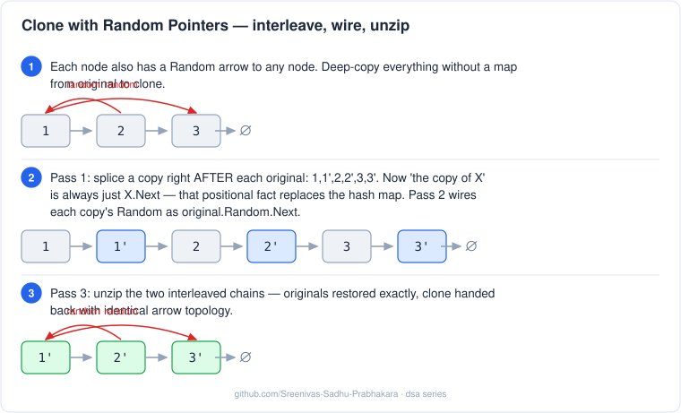

# Clone a Linked List with Random Pointers

> Striver SDE Sheet 038 · Day 7 LL & Arrays — interleave each copy right behind its original so Random targets resolve by position, then unzip. Go, stdlib only, tested.

## Problem

Deep-copy a list whose nodes carry, besides `Next`, a `Random` pointer to an arbitrary node (or nil). The copy must reproduce the whole pointer topology with brand-new nodes — and the interesting constraint is doing it without a hash map from original to copy.

## Approach

The map-free trick is positional: splice each copy node directly after its original (`A→A'→B→B'…`). Now "the copy of X" is reachable as `X.Next` for *any* node X — which is exactly what's needed to wire Randoms: `copy.Random = original.Random.Next`. A final pass unzips the two interleaved lists, restoring the original exactly and handing back the clone. Three passes, O(1) extra space, and the hash-map version remains the honest fallback when mutating the input even temporarily is unacceptable.

**Complexity:** O(n) time, O(1) extra space.

## Visual walkthrough

Read the picture top to bottom — each numbered frame is one moment of the algorithm
running on this repo's test example.

## Run

    go test ./...   # verify
    go run .        # demo

---

One of 191 repos solving Striver's SDE Sheet in Go — stdlib only, one problem per repo, every solution tested. Browse the set: [`dsa-*` repos](https://github.com/Sreenivas-Sadhu-Prabhakara?tab=repositories&q=dsa-&type=source).
